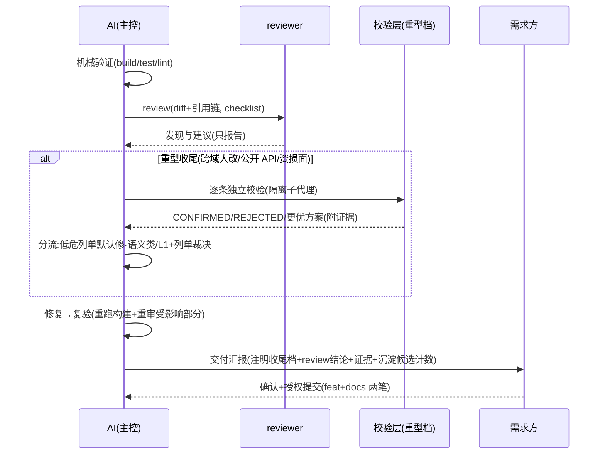

# crules-flutter

面向 **Flutter 工程**的 AI 协作规则 plugin：把「AI 怎么跟你安全地干活」固化成机制——危险命令硬拦、改动先过方案确认、交付必过审查、经验自动沉淀。
独立自持（源自 crules fork，2026-09 起 1.0.0 独立演进，史见 [CHANGELOG](CHANGELOG.md)）；许可 **MIT**（[LICENSE](LICENSE)）。

> 当前状态：1.1.5（版本编年史见 [CHANGELOG](CHANGELOG.md)）

---

## 装完得到什么

| 层 | 你得到 | 你要做的 |
|---|---|---|
| 守护 | hooks 自动生效：破坏性 git/rm 命令硬拦（强推/硬重置等，拦了就请你人工执行）、高危形态（下载执行 / sudo / chmod -R / filter-branch）弹窗由你裁夺、memory 漂移自动记队列、会话收尾提醒补索引、会话结束落一行遵守度事实账（只记计数与布尔、不含对话内容） | 无（全自动；高危形态弹窗确认） |
| 分工 | 7 个角色 agent 按职责自动挂载（写 UI → frontend、排障 → error、审查 → reviewer 只报不改…） | 无（自动触发） |
| 规范 | 宪法（`.claude/CLAUDE.md` 四行指针 + `.claude/crules/constitution.md` 副本——双 Gate / 证据分级 / 提交纪律）+ 审查清单与进阶篇（插件 cache 即读）+ AO 建议稿（人择） | init 引导逐项（见下） |
| 沉淀 | 记忆库 9 模板（项目事实锚点 / 业务事实 / 技术不变量 / 平台坑库…）+ `/distill` 知识定稿闸 | 日常顺手更新，收尾过闸 |

## 快速开始

```bash
# ① 一次性：装 plugin（git URL 源，user scope，不进任何项目 git）
claude plugin marketplace add https://github.com/BIG-BEARC/crules-flutter.git --scope user
claude plugin install crules-flutter@crules-flutter-market --scope user

# ② 在 Flutter 工程根目录跑（装好 plugin 后任何工程可用；命令带命名空间，裸名不可用）
/crules-flutter:init
```

**init 引导必填项**（逐项问、全落 `.claude/memory/PROJECT.md` 等 memory 件——宪法副本永不改）：

1. 技术栈（App 三选一 + 适配方案 / 字体策略，或 Plugin 二选一）＋档位三选一（轻量〔light〕 / 标准〔normal〕 / 完整〔full〕，默认标准）→ `PROJECT.md` §七 + 档位行
2. 项目附录（项目名 / 构建·分析·测试命令，协作偏好可选）→ `PROJECT.md` §十二
3. **支持矩阵** → `.claude/memory/platform-pitfalls.md` 头部（目标平台 + 各端实测版本上限；init 出机械读初稿，人核对补实测）

**装完日常零记忆负担**：agent/skill/hooks 全自动触发；只在交付收尾时走「机械验证 → review → 沉淀」三档化时序（下图，随任务规模裁剪件头），会话结束 Stop hook 会提醒补记忆库索引。

**第一次用？** 15 分钟走一遍最小闭环见插件 cache `进阶/上手教程.md`（1.1.5 去分发化——进阶不落项目根，cache 即读）。

### VSCode 扩展环境（无独立 claude CLI）

上方 `claude plugin marketplace add / install` 需要独立 claude CLI——VSCode 扩展环境（扩展内置 Claude Code、机器无独立 CLI）没有。替代：**用扩展内嵌的 claude 二进制代跑同款命令**（二进制随扩展升级换路径，不写死——在扩展安装目录现查）；装好后一切等价——`/crules-flutter:*` 命令、hooks、`plugin update`（同以内嵌二进制代跑）直接可用。init / 升级的源定位走 cache glob（见下方「升级」节），不依赖独立 CLI。

### 场景 → 入口（权威全表见 `/crules-flutter:help`）

| 场景 | 入口 |
|---|---|
| 新工程接入 | `/crules-flutter:init`（必填三处） |
| 日常开发 / 写方案 / 引依赖 / 排障 | 宪法双 Gate（`.claude/CLAUDE.md` 指针载入）· flutter-rules skill · `platform-pitfalls` 坑库 · `error` agent |
| 交付收尾 | checklist（插件 cache 即读）+ reviewer → `/crules-flutter:distill` |
| 复刻 / 重写 / 迁移既有模块 | **parity-rewrite** skill（对照清单钉住原行为 → 逐项重建 → 测试矩阵验证一致） |

**出问题看哪**（排查序）：行为不符预期 → `/crules-flutter:help` 查场景归属 → 仍不明 → `memory/MAINTENANCE.md` → `CHANGELOG.md` 查能力引入版本。

### 命令面板（×5）

| 命令 | 用途 |
|---|---|
| `/crules-flutter:init` | 工程接入（丁-Copy 落位 + 必填项引导；重跑 = 升级刷新） |
| `/crules-flutter:help` | 场景使用地图（什么场景用什么） |
| `/crules-flutter:distill [--scope <需求>]` | 知识沉淀定稿（候选分组预览、逐组人工裁决后落盘） |
| `/crules-flutter:diagram <文件>` | 存量人读文档补 mermaid 图 |
| `/crules-flutter:update-memory` | 记忆库索引全量刷新（兜底） |

### 收尾时序三档（review 主工位）

<!-- gen:gear-note -->
<!-- 仓内维护者勿手改：本块由 canonical/gear-note.md 生成 -->
**收尾档按任务规模三档判定，与项目档位无关**：极简（单点修复 / 文案 / 注释，无行为面变化）＝机械验证贴输出 + 一行汇报，review 豁免记 Gate 例外台账、无沉淀件头；标准＝下图主体（现行时序）；重型（跨域大改 / 公开 API / 资损面）＝标准 + 校验层（下图 alt 块）。**项目档位**（init 一问定，写 `.claude/memory/PROJECT.md` 档位行，无行 = 默认标准）：轻量〔light〕＝记忆库关（停维护；PROJECT.md 档位锚点留）·编排关·极简收尾占比高；标准〔normal〕＝日常工程默认；完整〔full〕＝编排开·plan-reviewer 默认启用。两轴独立——轻量档大需求仍走 plan-reviewer、大改仍走重型收尾；档位只改行为件头，不减常驻 token。
<!-- /gen:gear-note -->



## init 往工程里放什么（丁-Copy，1.1.5 起）

**全部落 `.claude/`（未跟踪本机态）——受控文件零接触，消费工程 git 仓库与文档零 crules 元素**。分流自动判定：`.claude/CLAUDE.md` 有戳（已接入）→ 刷新路径（副本对拍 + 指针重写即刷戳，引导仅补未填项）；根 `CLAUDE.md` 有戳（丁-tracked 老形态）→ 不自动迁移（存量原子切 = 阶段 4 一次性授权批，提醒≠代执行）；项目自有宪法（根 `CLAUDE.md` 无戳）→ 可共存。副本已存在且对拍不一致 = 被手改信号，呈 diff 呈人裁决后继续。

| 落位物 | 位置 | 说明 |
|---|---|---|
| 指针四行 | `.claude/CLAUDE.md` | 版本戳行 + 宪法导入行 + memory 导入行 ×2——全内部相对导入零审批面；`-p` 直载与 compact 后重读均实测通过（四行配方单源见 `commands/init.md`，勿他处复制） |
| 宪法副本 | `.claude/crules/constitution.md` | App / Plugin 二选一；pristine（项目事实不写入、可哈希对拍），不按档删改 |
| memory 种子 9 件 | `.claude/memory/` | 含 `PROJECT.md` 项目事实锚点 / `reference-map.md` 分域参考系 / `platform-pitfalls.md` 平台坑库——缺则补、**永不覆盖**（落地即项目制度资产） |
| AO 建议稿 | `.claude/memory/analysis-options.suggested.yaml` | 人择通道：采纳 = 手工并入项目 `analysis_options.yaml`（受控文件，AI 不代写）后置 `.claude/memory/.crules-state` 的 `ao_adopted=1` |

agents 不复制——plugin 已自动挂载 7 角色（`crules-flutter:frontend` 等）；checklist / 进阶不再落项目根——插件 cache 即读（去分发化）。整体回退：删 `.claude/CLAUDE.md` 指针连同 `.claude/crules/` 即净（`.claude/memory/` 为项目资产，去留自裁）。

## 升级

`plugin update` 更新 plugin 通道（hooks / agents / skill / 命令 / 模板源）；工程侧**重跑 init** 即刷版本（幂等）：

```bash
/crules-flutter:init    # 刷新路径：副本对拍 + 指针重写即刷戳；memory 永不覆盖、引导仅补未填项
```

巡检（cache 内跑）：`bash scripts/check-imports.sh <项目根>`——戳读链 `.claude/CLAUDE.md` 指针戳优先 → 根 `CLAUDE.md`（丁-tracked 存量）回退；查版本差与 memory 模板演进。

1.1.3–1.1.4 的 install.sh 三向合并升级语义（`--upgrade` / `--force` / base 快照）已随分发职责退役（1.1.5）；存量丁-tracked 工程迁移 = 阶段 4 一次性授权批。

**记忆库兜底**：`/crules-flutter:update-memory`——索引全量刷新（日常仍以「写代码顺手更新」为主，见 `.claude/memory/MAINTENANCE.md`）。

## 环境要求与更新信任

- **环境要求**：macOS / Linux，hooks 依赖 `python3`（无则自动回退 `python`）。**Windows 可用**（1.0.17 起实机验证完成）：hooks 是**开发机**上的工具（Claude Code 宿主环境），与「App 的部署目标平台」是两回事——POS 收银机是 App 跑的地方，不影响 hooks。Windows 上 deny-list 双实现：Bash 工具会话走 Python 版、PowerShell 工具会话走 PowerShell 版，破坏性命令两域都拦；漂移队列与收尾提醒仍需 python。**已知边界**：EncodedCommand / 变量拼接等混淆形态不拦；解释器缺失、闸自身崩溃等极端情形回退 Claude Code 原生权限确认兜底。逐版本加固编年（码页缺陷族 / 启动失败重试 / 闸失效兜底）见 [CHANGELOG](CHANGELOG.md) 1.0.17–1.0.25
- **更新信任（供应链）**：本 plugin 的 hooks 在每次 Bash 调用前执行——`plugin update` 后新 hook 代码静默生效，被污染的更新 = 任意代码执行。建议 update 前先看 hooks 变更（`git -C <本仓> diff <旧tag>..<新tag> -- hooks/`）或锁定 commit。

## 停用 / 恢复 / 共存

| 操作 | 命令 |
|---|---|
| 停用（可逆） | `claude plugin disable crules-flutter@crules-flutter-market` |
| 恢复 | `claude plugin enable crules-flutter@crules-flutter-market`（**完整形态**，纯名会 not found；**新会话生效**——当前会话不装载 hooks，别在旧会话验证） |
| 彻底卸 | `claude plugin uninstall crules-flutter@crules-flutter-market` + `claude plugin marketplace remove crules-flutter-market` |
| 项目级整体回退 | 删 `.claude/CLAUDE.md` 指针连同 `.claude/crules/`（crules 落物全在 `.claude/` 本机态——受控文件零残留；`.claude/memory/` 为项目资产、去留自裁） |

**与其他规则 plugin 共存**：同一项目二选一（勿与其他全量规则包双装）；同机器不同项目各装各的无冲突——万一两套 hooks 同项目双跑：deny-list 并集拦截（任一 deny 即 deny，deny > ask 优先级官方明确，保守无害）、pending-updates 队列按会话分文件（1.0.30 起，各会话互不写同一文件；仅无 session_id 的旧宿主退化为共享单文件，POSIX 经 flock、Windows 原子追加）。

---

## 维护（以下面向本仓维护者）

按触发时机分四组；新义务先归组再落笔，防清单长回平铺一锅粥。

### 发布操作

- 本仓独立演进：bump 双 json → `plugin update` → cache 特征串验证（步骤细节见 `scripts/release.sh` 头注与 CHANGELOG）
- **deny-list 双源同步义务（1.0.17 起）**：判据改 `hooks/deny-list.py` 与 `hooks/deny-list.ps1` **两源同改**（函数对照表在 ps1 文末），夹具单源 `hooks/fixtures/deny-list-cases.json`（lang 标 both/bash/ps），改后两驱动全绿（本机无 pwsh 则 SKIP，CI pwsh 步硬拦）；新增绕过形态 fixture-first

### 每次 minor 例行（发布单，从上到下过一遍）

- **基线复测**：`/context` 快照，**新装 / 消费工程各落一档**——实测数**不落本节**、随 minor CHANGELOG 条落（见下条观测带数①；本节留快照句必过期——1.0.7 的数挂到 1.0.32 才被发现即实证）。口径：15K 线度量**本包模板常驻负担**，单位 **token**（即 `/context` 显示值）；`/context` 的 Memory files 混入项目自身内容——破线先分离归因（模板 vs 项目 CLAUDE.md 膨胀），项目侧膨胀应裁项目侧 / 走记忆库下沉，而非触发模板瘦身（历史测量记录见 CHANGELOG）
- **观测带数**（防度量体系「建了没人看」）：CHANGELOG 的 minor 条目固定带两数——① 常驻基线快照（新装 / 消费工程各一档）② distill 四数（总发现数 / 采纳率 / 误报率 / 按验证状态分桶的误报率——与 distill §7 同源；`<30` 样本记数不计率，**0<N<30 悬空态显式进度行「样本 N/30」、禁渲染「无」**）；数据源 = 消费工程 `.review-ledger`，本仓不汇聚（本机私域口径不变）。**四数止损线**（1.0.9 外审 🟡3 处置；1.0.11 批C 改**时间触发**——版本里程碑可能长期不达，时间线更硬；1.0.31 条件修正）：**2026-12-31 前累计仍未跨 30**（自 1.0.3 建制起）→ 按「治理从简」砍四数、只留 ledger 原始账——不维护一套永不产出的指标；**到期未达标先诊断再砍**：「distill 调用数低」（真无人用，砍）与「调用在而 ledger 回填断链」（reviewer 尾提醒未落，修链）两因分开裁，防活机制错杀（2026-09-24 批A）；配套：distill §7 空态输出显式异常行（不静默「无数」）、reviewer 复核结论尾固定提醒主控回填。**首个 distill 周期**列观测项第一——它跑通与否决定沉淀闸整套机制是资产还是死重
- **skill 平台坑节扫描**：Flutter / 平台大版本出现 → 扫 skill 坑节标【待重验】→ 核验刷新
- **预设栈审视**：app 模板 §七 预设的包维护态与争议项按「最后核验」日期例行刷新
- **docs 轮次化**：清点 `docs/`——状态戳已「已落地 / 已废弃」且所属批全部落地的方案 / 评审 / 复盘，正文归档或删（结论已被代码与 CHANGELOG 吸收，git 可寻回；**被分发面引用的 docs 先去引用再删**，防悬空指针）；裁决中途的保留至批落地。**可删判定外置核实**：以 git tag / 落地 commit / 实物在树为准，状态戳与依据链转述只作线索（1.1.2 实证：10 篇可删中 5 篇戳过期）；删前逐篇本体挂起项扫描（待裁 / 待批 / 另批族词）零命中方可删。**落地批同批回写所闭 docs 状态戳为终态**（戳失真在本源生成，清点端只兜底）。**清点挂钩 minor 位跳变的收口批同轮**——`grep -n "^> 状态" docs/*.md` 跑一遍（再积压一次则评估上闸）。**裁决索引即状态戳**：每篇头部 `> 状态：…` 必含下一步动作（如「待需求方逐条裁 §6」），全部等待态一查即得（读的是本体，无第二份索引可漂移）
- **同文块改动（1.0.12 起）**：各**逐字同文**内容块（档位预设节 / 收尾时序行 / Gate 例外段 / help↔README 档位说明段 / agents 双卡聚合例外判定线句 / §一 两条「引用实测依据」「评审两核」红线；块数以 scripts/render-blocks.py 登记表为准）已生成化——改 `canonical/<id>.md` 后跑 `python3 scripts/render-blocks.py` 重新生成，**勿直接改目标文件的围栏区**（`<!-- gen:… -->` 之间由生成器接管；CI 生成闸 + 锚串守卫会红）。**尾随空行语义**：canonical 文件尾的空行被剥离（需块内尾随空行须写进正文）

### major 版本前（1.x 升版时跑，minor 不跑）

- **外审**：独立 subagent 全文重读本仓；**风险面必答**——上下文经济（常驻基线 vs 15K 线）/ 实效度量（ledger 四数 / distill 弃用率）/ bus factor / 待裁事项清点；通用面兜底——易用性（含信息架构）/ 方法论深度 / 机制化 / 可维护性 / 分发工程。产出发现走 review-ledger，评级仅趋势参考不作门槛；**覆盖面以账本为准**——外审产物附基于 `find` 全量清单逐项标注的读取台账（已读/部分读/未读），覆盖面声明以台账为准、不以评审者自报为准（自证不可靠，验证须外置；实证：2026-09-15 外审**四次**自报超卖——三次覆盖面〔1/9 references、6 文件、孪生段 81-170 行〕+ 一次**事实声明**〔CHANGELOG 写「副作用已核」实未实跑〕，四次均由外部触发〔质询/评审指令/独立 review〕暴露，主动自查捕获为零）；**角色卡 model 档位复核**——agents frontmatter 硬编码模型代号（opus/sonnet/haiku）随模型演进过期，每次外审点名复核（Agent编排.md 亦自注此义务）

### 原则与观测项（不随版本触发）

- **治理从简**：README + CHANGELOG + 最简检查（五维雷达/评审轮次体系**不引入**——治理成本延后到真有痛感再付）；**新闸带止损线**——机械闸新建须同时登记触发条件与到期动作（何时砍/何时裁），防「建了没人敢砍」的机制堆积（同族先例：四数止损线、批3「跑三轮无发现即砍」；2026-09-24 批A）
- **单项开关治理**：模板内单项开关上限 6；既有协作偏好 4 字段（固定语言 / 提交触发词覆写 / 提速档 / 沉淀闸档位）与档位预设并列、不计入上限；开关数超 6 触发「收敛成新档位」复核——治理口径属维护者面，1.0.8 自双模板 §十二 外迁至此（消费面只留行为结果，不留治理规则）
- **定期外审选项保留**（独立 subagent 复审模式可复用，防规则滑向单项目特有）
- **沉淀闸蜜月期**：真实试点上前 5 次 `/distill` 建议全闸档校准（人工改写条目多 = AI 判准偏差信号）；观测项：弃用率、`/context` 常驻快照、skill 触发体积

### 概念地图（维护者速查）

> 全仓机制速览——每行给「一句定义 + 权威落点」；**只索引不复制正文**（正文改动不必同改本表）。新人接手 / 半年后自查先读本表。

| 概念 | 一句定义 | 权威落点 |
|---|---|---|
| 双 Gate | 非平凡改动先需求确认（要解决的问题/范围/验收）、再方案确认（七要素） | 双模板 §三 |
| 收尾三档 | 极简（机械验证+一行）/ 标准（+review）/ 重型（+校验层）——按**任务规模**判 | 双模板 §三 |
| 项目档位 | 轻量〔light〕/ 标准〔normal〕/ 完整〔full〕——init 一次定，改行为件头不减常驻 | `PROJECT.md` 档位行（定义：双模板 §十二） |
| 证据 5 级 | 静态 → 构建 → 测试环境 → 目标环境 → 生产，逐级不可互推 | 双模板 §四 |
| 可达性 L0-L2 | 代码路径成立 / 触发条件存在 / 业务真实可达——**AI 能力上限是 L1** | 插件 cache 进阶/审查与复核纪律 |
| 校验层 | review 发现的隔离子代理二次质检（重型收尾专启），三值结论 + 分流 fail-closed；「更优方案」系校验者主张非已验证事实 | 插件 cache 进阶/审查与复核纪律 |
| 沉淀闸 | 直写（复盘/索引/描述性 patterns）/ 走闸（业务规则/不变量/坑卡）二分 | MAINTENANCE「沉淀直写与走闸」 |
| 沉淀闸档位 | 分流（默认）/ 全闸 / 降级宽松——独立字段，AI 不得自行升降 | distill「档位」 |
| 提速档 | standing instruction 走 Gate 例外，须圈死范围/规模/验证档三要素 | `PROJECT.md` §十二（定义：双模板 §十二） |
| 两类台账 | `.review-ledger`（裁决，供四数聚合）/ `.gate-exceptions`（豁免，供事后审计）——均不进 git | distill §7 / §三 Gate 例外 |
| 遵守度事实账 | `.compliance-log`——SessionEnd hook 每会话落一行**事实**（计数/布尔，无正文），量化「宪法被遵守几成」；记而不判，聚合裁决未接线（批3 裁） | hooks/compliance-audit.py / docs/普查-2026-09-22 |
| 观测带数 | 每次 minor 的 CHANGELOG 必带：常驻基线快照 + distill 四数 | README「每次 minor 例行」 |
