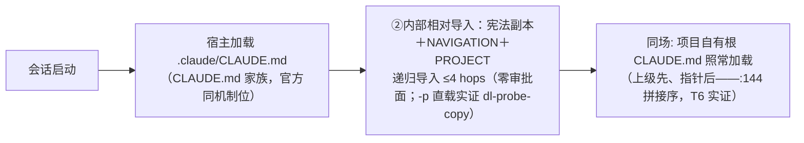

# 宪法载体丁-Copy — 方案 v4.0（Q6 已裁丁-Copy；T2 双绿已判；余 Q3/Q4/Q5）

> 状态：**定稿 v4.0（2026-10-15——Q6 载体源已裁：丁-Copy〔依据=需求方对「主控倾向丁-Copy」停点回「继续」〕；T1 审批闸与 R1 随之销项、T2 双绿判实〔10-15 手跑：交互载入＋compact 存续均实证〕、设计空间关闭声明 §3.3。阶段 2 全件已落工作区〔零 commit〕——核心件＋install.sh 分发退役批（10-15 落）：install 桩化退役、check-imports 戳链迁移、双模板/README/help/MAINTENANCE 手改扫尾、test-self 断言区重写 56 绿；批 2.6 引用面 ~40 处切新口径〔10-16〕；外审修正批〔10-16，reviewer 15 项——R3 证伪、R7 随批入库、余 13 修：双模板「复制后手改」旧指令清零＋新闸、轻量档重定义〔仅删指针 ③ 行、PROJECT.md 锚点必留〕、stop-reminder 按戳形态分叉、init cp 守卫与 R0 基线对比〕57 绿）**。裁决链：戊 v1（10-14，注入）→ 评审 1（4 修订/5 提示/0 否决）→ v2 → 需求方三裁（零 CLAUDE.md 接触 / 零仓元素 / R0）→ 载体竞标（「确定没有更好的方案了？」）→ 四探针证 CLAUDE.local.md 与 `.claude/CLAUDE.md` 自动加载 → 丁-Local 提案 → **评审 2（0 否决 / 5 修订 / 6 提示 / 1 销项，「丁-Local 修订后成立」；承重断言主控二验全中，发现 5 经两探针预闭）** → v3 → **10-15 探针级联（v3.1）：`-p` 态外部导入双二进制（2.1.286 CLI / 2.1.299 扩展内嵌）实证全红＋丁-Copy 副本形态 `-p` 全绿 → Q6 → v4.0 裁丁-Copy 定稿**。前稿戊 v2 被吸收取代（注入设计压缩为 §4.7 compact 专线），文件已删；本稿 v3.1 前身为「宪法载体丁-Local」同名稿（未入 git，v4.0 原地改名定稿——旧名无外部引用，已核）。
> 关联：[方案-2026-09-23-升级合并体验优化.md](方案-2026-09-23-升级合并体验优化.md)（丁稿——§3.1 配方两处修正、§3.4 E 行改写随 Q5 批）；消费侧 `saas-cashier/docs/复盘-2026-10-14-宪法丢失与分发面事故.md`。
> 定稿层（Q6 已裁、待终审），未动任何生产脚本。✅=亲验（附 file:line / 路径）；⚠️=转述或论点；❓=推断待裁（入 §9）。

## 0 硬规则（需求方 2026-10-15 裁，本稿红线）

**R0：常态机制永不写消费工程受控文件**——安装器、hook、命令、AI 会话的一切常态写动作，触碰面限两类：plugin cache 自足物；项目内**未跟踪**本机态（`.claude/` 通用约定目录——三工程已自有 ignore 行：工程一根 `.gitignore:111` / 工程二 `:77` / 工程三 `:111`，实证零新增写需求）。对齐既有「提醒≠代执行」原则的推广。存量清理与迁移=一次性授权批（§7 阶段 4/5，逐笔呈 diff，Q3）。

## 1 目标与范围

**要解决**：superpowers 形态——使用 crules-flutter 而消费工程**仓库零 crules 元素、受控文件零改变**；宪法全效（纪律层 / 锚点 / 升级通道 / 观测面）经 CLAUDE.md 家族文件导入通道＋未跟踪本机态交付。

**不做什么**：AO 静态层随发（R0 推论，§4.5）；团队共享面（章程不变）；不启用 SessionStart 注入（戊整体降长期观察，唯一保留条件=compact 专线，§4.7）；不废丁-tracked（降回退形态，配方随 Q5 修正）。

**老行为变更清单**：无（Q6 已裁未实施；实施随阶段 2 授权批）。

## 2 核心决策

| # | 决策 | 分级 |
|---|---|---|
| C1 | 载体=**丁-Copy**（Q6 已裁 2026-10-15）：未跟踪指针 `.claude/CLAUDE.md` **四行配方**——①戳行 `<!-- crules-flutter: vX.Y.Z -->` ②`@crules/constitution.md`（内部相对导入；宪法副本落 `.claude/crules/constitution.md`＝cache 当版剥 :333 派生）③`@memory/NAVIGATION.md` ④`@memory/PROJECT.md`（后两行相对基=含导入文件目录，即项目 `.claude/` → 恰命中 `.claude/memory/` 两件）。**指针文件即门控**（在=生效，删=零残留），`.crules-mode` 标记取消。`.claude/CLAUDE.md` 是 CLAUDE.md 家族**唯一零写落点**——CLAUDE.local.md 需新增 tracked ignore 行即违 R0，三工程均无此文件（评审 2 反证实证） | ✅ 全配方 `-p` 亲验（dl-probe-copy：宪法原句级召回＋双锚逐字回显）；零审批面 |
| C2 | 两层拆分：通用纪律层（cache 经 @ 导入）＋项目锚点层 `.claude/memory/PROJECT.md`（§七 / §十二 / 支持矩阵）；锚点留 `.claude/memory/`，与 `find_project_root` 定根锚（[hooks/_common.py](../hooks/_common.py) `:19-24`）同层不分裂（评审 2 #3） | ✅ |
| C3 | 戳=指针首行；`constitution_stamp` 读链迁 `.claude/CLAUDE.md` 优先 → 回退 root/CLAUDE.md（存量平滑）。调用方全枚举（评审 2 实证）：stop-reminder.py:103、compliance-audit.py:230、夹具 ×2、文案串——单点改路径＋夹具＋文案即成。陈旧语义=戳 ver vs `plugin_version`（读 CLAUDE_PLUGIN_ROOT，_common.py:40-47）→ stop-reminder 催 `/crules-flutter:init` 刷指针 | ✅ |
| C4 | 戊处置：SessionStart 注入降**长期观察**；唯一保留条件=**compact 专线**（T2 不过闸则启用，§4.7）——非整体回退位 | ✅ T2 双绿（10-15）→ 专线不启用、存档 |
| C5 | **AO 停发＋建议稿通道**（R0 推论）：三工程基线从未生效（根 AO 229 行 / 子 79 行均只 include `flutter_lints`、伴生 inert；工程二 / 三无 crules AO）——停发零功能损失；基线 36 行改由命令输出为建议稿落 `.claude/memory/`，采纳=需求方手工并入自己 AO（人择不违 R0）。`ao_adopted` 位随 `.crules-mode` 取消迁 `.claude/memory/.crules-state`（一行态文件：ao_adopted=1；form 位不再需要——指针即门控；评审 2 #10） | ✅（三工程实证） |
| C6 | checklist / 进阶**去分发化**：reviewer 权威源本在 `进阶/审查与复核纪律.md`（agents/reviewer.md:10「权威正文」、:48 工作流首读）——agent 定义改读 cache 路径；根 checklist.md / 进阶/ 分发退役，install.sh 分发职责随之退役（仅存迁移辅助） | ✅（现状即如此） |
| C7 | 回退矩阵：未迁工程=现状照旧零动作；已迁工程=**删指针文件（连同 `.claude/crules/` 副本）即回 pre-丁态**（比戊的「回丁重装」更简——指针可删可重建，init 一键）；删存量模板拷贝前先落 `.crules-base` 快照（坑 1 教训）；如需回丁-tracked=§4.6 修正配方 | ✅ |
| C8 | agents 记忆库联动行补 `PROJECT.md` 指针（现 0 命中）——「可 Read」变「会 Read」。**保留为必要件非可选**：官方 :376 暗示存在「不带项目指令启动」的子代理形态，继承先验不覆盖全部形态（评审 2 #6） | ✅ 可落 |
| C9 | 必测九件（§6.2）不过闸则丁-Copy 不成立，现状照旧——零沉没 | ✅ |

## 3 现状与新证据

### 3.1 演进编年

| 时点 | 事件 |
|---|---|
| 09-23/24 | 丁稿 §3.4 否决 E；裁丁-tracked 为终态；必测三件 PASS（根 CLAUDE.md `@` 导入通道，含子代理逐字继承 num_turns:2）；工程三 `.claude/memory/` 落盘（09-23 17:00，来源待考——D-4 拒装与盘面并存，Q1） |
| 10-14 | 消费侧事故链（覆盖 / untracked 真消失 / compaction 险凭摘要重建 / 同事 add 请回）；工程一二裁「crules 产物全部移出 git」 |
| 10-14/15 | 戊 v1 → 评审 1 → v2 → 需求方三裁；载体竞标 → 四探针 → 丁-Local → 评审 2 → v3 |
| 10-15（续） | 探针级联：`-p` 态外部导入双二进制全红（字面留置）；符号链接 / `additionalDirectories` 均不破；丁案 09-24 `-p` PASS 因版本漂移作废；**丁-Copy（内部副本＋相对导入）`-p` 全绿出线（§3.2）——载体源分叉 Q6** |
| 10-15（裁） | **Q6 裁丁-Copy**（需求方对「建议丁-Copy」停点回「继续」）→ v4.0 定稿：T1/R1 销项、②行定稿、文件改名「宪法载体丁-Copy」；同日 compact 存续官方全表入档（T2 文档级判绿） |
| 10-15（验） | **T2 手跑双绿**（需求方交互会话双帧截图＋沙盒地面真值 cat 对拍）：标记串 compact 前后逐字命中、§三 双 Gate 要素全录、compact 后指针链仍被读——C4 专线落定不启用、R2 出案、交互态 darwin 空白收窄 |
| 10-15（批） | **install.sh 分发退役批落地**（工作区零 commit）：install 桩化（任意形态 exit 1 指引 init、零写入）＋check-imports 戳链迁移（指针优先→根回退）＋canonical×4 与双模板/README/help/MAINTENANCE 扫尾＋test-self 断言区重写（删 ~13 条死断言、增退役/戳链/零残留守卫，56 绿）——阶段 2 全件收齐 |
| 10-16（批） | **批 2.6 引用面切丁-Copy 口径**（退役批后置新发现——进阶/skills/agents/memory 种子 ~40 处死指针）：「项目根 CLAUDE.md」→「宪法（指针→副本）」、「项目根 checklist」→「插件 cache」、git 分层口径对齐（工程自裁纳管）、AO 人择句、checklist 指针限定闸翻转（同 cache 树新地理学、grep 收窄 `` `checklist.md` `` 防 parity 模板名误咬）——56 绿 |
| 10-16（修） | **外审修正批**（reviewer 隔离子代理 15 项：L1×3/L2×6/L3×6；R3 证伪〔档位锚串实在、闸实绿〕、R7 随批入库解、余 13 修——台账落 `.review-ledger`）：R1 双模板「复制后手改」旧指令族清零（选择全落 PROJECT.md）＋零残留新闸；R2 轻量档重定义——仅删指针 ③ 行、PROJECT.md〔档位/§七/§十二〕锚点必留（init/双模板预设块与接线段/canonical gear 三面同源）；R4 checklist AO 人择口径；R5 进阶 checklist cache 限定（审查纪律 2 处同类补）＋闸扩进阶；R6 stop-reminder 按戳形态分叉（丁-tracked 报迁移批、不催 init 死路）；R8 NAVIGATION 补 PROJECT 行；R9 init 去行号引与内部码；R10-R12 init 三处 cp 加守卫；R11 R0 基线快照对比；R13-R15 如实面修正——57 绿 |

### 3.2 机制实证（2026-10-15 探针与实查，全 ✅ 亲验）

- **`.claude/CLAUDE.md` 自动加载**：/tmp/ao-probe2（无根 CLAUDE.md，仅 `.claude/CLAUDE.md` 标记串）`-p` 逐字回显 `DOT-CLAUDE-DIR-PROBE-9c2e-marker`；CLAUDE.local.md 同证（/tmp/ao-probe）。**边界：单机 darwin、`-p` 形态**——交互态已由 T2 补证（10-15）；Windows 未测。
- **上级目录与 worktree 位形可达**（评审 2 #5 预闭）：cwd=`/tmp/ao-probe2/sub/deep/` 与 cwd=`/tmp/ao-probe2/.claude/worktrees/wt-x/` 两变体均逐字回显同标记串——指针从深层 cwd 可达。留 pilot 期一例**真** git worktree 抽检（工程三在产 14 个 `.claude/worktrees/`，实证）。
- **官方机制文本**（docs.claude.com memory 页存盘件，行号为存盘件）：:61 `.claude/CLAUDE.md` 与根 CLAUDE.md 同为 Project instructions 位（**不依赖 --add-dir 限定语 :164**）；:104 相对导入基=含导入文件的目录；:123 CLAUDE.local.md 与 CLAUDE.md 同权；:127-130 `@~/...` 形态官方示例在案；:132-138 **外部导入审批**——项目级 memory 文件内解析到工作目录外的导入，首遇弹审批对话，「If you decline, the imports stay disabled and the dialog doesn't appear again」（拒绝即永久静默禁用，恢复路径未文档化）；:142-144 逐上级加载＋拼接序（上级先、local 后）；:369 AGENTS.md 抑制判定计入 `.claude/CLAUDE.md`；:376 子代理可「不带项目指令启动」；:512/:531 auto memory 落 `~/.claude/projects/<project>/memory/`。
- **宪法内链断裂实证**（评审 2 #2）：[app/CLAUDE.md](../app/CLAUDE.md):333 有相对导入 `@.claude/memory/NAVIGATION.md`；cache 五版（1.0.20/1.0.48/1.1.1/1.1.2/1.1.3）均无 `app/.claude/`，NAVIGATION 实际在 `<ver>/memory/`——指针形态下该内链解析基=cache `app/`，空导入静默。**丁-tracked 同病**（丁稿 §3.1 配方未闭此内链）。处置=阶段 2 移除 :333（分发面退役后无消费者）＋指针第 ③ 行直达 NAVIGATION。
- 戳链调用方全枚举（评审 2 实证）：`constitution_stamp` 全仓调用仅 stop-reminder.py:103、compliance-audit.py:230（另夹具 ×2 与 stop-reminder.py:108 文案串）；`find_project_root` 锚 NAVIGATION.md 不动，定根语义零变。
- 工程三 AGENTS.md 与根 CLAUDE.md 并存（实证）——:369 抑制对其现状无改变，init 仍需检测提示（未来 AGENTS.md-only 仓）。
- crules 1.1.3 cache 全目录含 进阶/（「cache 内即读」成立）；宪法源 `app/CLAUDE.md` 仓内 git 版本化。
- **销项**（评审 2）：auto memory 与 `.claude/memory/` 命名空间冲突不存在——落点零交集。
- **`-p` 态外部导入不载（10-15 探针级联 ✅ 双二进制）**：/tmp/dl-probe（`~` 形）/ dl-probe-abs（绝对形）/ dl-probe-root（根 CLAUDE.md 形）在 2.1.286（本机 CLI `~/.claude/local/claude`）与 2.1.299（扩展内嵌二进制）行为一致——`@` 行**字面留置不展开**、宪法正文缺席；同场相对导入（`@memory/…`）照常载入（T5 正半场两形态均绿）。符号链接指向 cache 同死（dl-probe-sym，官方：按目标判外部）；`permissions.additionalDirectories` 纳入 cache 目录**不内化**外部判定（dl-probe-add）。无持久化拒绝态（`~/.claude.json` 零相关键）——未污染后续交互会话。**推论**：丁案 09-24「必测三件 PASS」之 `-p` 证据作废（当时扩展二进制行为不同，版本漂移）；其子代理逐字继承结论同步降「当时版本成立」。
- **官方文本 10-15 重取（读证 ✅，code.claude.com/docs/en/memory，重取件行号）**：审批对话「asks for that approval once per project, in a dialog at the start of an **interactive session**」（:255）——仅交互会话弹（与 `-p` 跳过自洽，闭 T1 `-p` 半场之「放行/拒绝/跳过」三择=**跳过**）；**「If you decline, the imports stay disabled and the dialog doesn't appear again.」**（:133，与 10-14 存盘件逐字一致——该句今证升级为 10-15 在案原文）；用户域（`~/.claude/CLAUDE.md`、`~/.claude/rules/`）导入免审批但**全局生效**（:135/:255「apply to every project on your machine」——无法按工程门控，不采）；HTML 块注释注入前剥离（:150，**戳行零 token**——C3 附带收益）；`.claude/rules/` 文件不计入 AGENTS.md 抑制判定（:370）；**批准态持久化暗示**（:428 AGENTS.md 差异表：外部导入「Loads only if you already approved external imports for this project, with no prompt」——批准按工程记忆、后续不重弹；`-p` 是否同享仍待 T1 实测）；宪法单文件上限 4 MiB 载满（:550，30KB 远低）；根 CLAUDE.md compact 后重读重注入（:625——`.claude` 形态已由 T2 实证，10-15）。存盘件仍会被宿主清退——引文已逐句转录本稿，为准。
- **丁-Copy 副本形态 `-p` 全绿（10-15，/tmp/dl-probe-copy ✅）**：宪法副本落 `.claude/crules/constitution.md`（cache 1.1.3 `app/CLAUDE.md` 30706 字节，剥 :333 后 `@` 行清零）＋指针四行（②改 `@crules/constitution.md` 内部相对导入，③④锚点行不变）——`-p` 三问全中：「三、标准工作流（双 Gate）」「证据强度（验收证据 5 级）」**原句级召回**＋双锚标记逐字回显。零审批面、零对话、headless 直载。
- **插件自带 CLAUDE.md 通道官方关死（10-15 读证 ✅，code.claude.com/docs/en/plugins-reference）**：原话「A `CLAUDE.md` at the plugin root isn't loaded as context, and `claude plugin validate` warns when it finds one. To include instructions that load into Claude's context, put them in a skill.」——插件指令通道官方指定=skill（按需制）；常驻上下文无插件原生通道（SessionStart 注入=戊，仍是 hook 通道）。另录：`${CLAUDE_PLUGIN_DATA}`（`~/.claude/plugins/data/<id>/`，跨 update 保留）为**插件级全局**持久态目录——非上下文通道、非按工程门控，不适用本案（`.crules-state` 是按工程态，留项目 `.claude/`）。
- **compact 存续官方全表（10-15 读证 ✅，code.claude.com/docs/en/context-window「What survives compaction」）**：「**Project-root CLAUDE.md and unscoped rules → Re-injected from disk**」（project-root CLAUDE.md=含 `.claude/CLAUDE.md` 备位，与 memory 页 :70 同一概念——**T2 文档级判绿→当日手跑双绿**，§6.2）；「Context that hooks added earlier → Summarized with the rest of the conversation」（戊无 compact matcher 时注入内容被摘要吞——C4 降级判断的官方印证）；「**SessionStart hooks that match the `compact` source → runs them and adds their output to the compacted context**」（§4.7 专线 `matcher: compact` 设计与官方机制逐字吻合）；另「If a rule must persist across compaction, drop the `paths:` frontmatter or move it to the project-root CLAUDE.md」——project-root CLAUDE.md 即持久化金标准；skill 体 compact 后重注入但每 skill 5k/总 25k token 截断。

### 3.3 载体竞标（为什么丁胜戊注入——丁内载体源 Q6 已裁丁-Copy）

| 维度 | 戊·SessionStart 注入 | 丁·未跟踪指针（载体源已裁丁-Copy） |
|---|---|---|
| 子代理继承 | ❓ 零先验（T2 全新证） | **先验强化**：与丁案已证根形态同 CLAUDE.md 家族机制（官方 :61 同位）；仍非已证——T3 实测（评审 2 #6 降格） |
| 新增组件 | 注入脚本＋hooks.json 注册＋体积断言 | **零**（init 扩＋_common 戳链迁移而已） |
| 门控 | `.crules-mode` 标记（新设计件） | 指针文件本身（评审 1 #1 一案两义随之消失） |
| -p 已有实证 | T0 开口（-p 是否触发 SessionStart 未证） | ✅ 探针 B 在手 |
| compact | ✅ matcher 显式含 | ✅ T2 双绿（10-15 手跑——`.claude/CLAUDE.md` 形态亲证） |
| 劣处 | 宿主 SessionStart 语义依赖 | 两处：外部导入审批面＋update 后首会话裸奔窗（§8 R1/R4，如实定价） |

**载体源子竞标（10-15 新证后丁内部分叉——Q6 已裁丁-Copy，2026-10-15）**：指针落点 / 戳 / 门控 / 锚点 / ③④行两态完全共用，分叉仅在②行宪法源——

| 维度 | 丁-Local（②=cache 绝对导入） | 丁-Copy（②=内部相对＋`.claude/crules/` 副本） |
|---|---|---|
| 审批面 | 有：交互首会话每工程一弹（10-15 官方文本）；拒绝→永久静默禁用风险（R1） | **无**（全内部导入） |
| `-p` 态 | ❌ 实证不载（双二进制）；批准后 `-p` 是否放行=未知 | ✅ 实证全载（dl-probe-copy） |
| update 后窗口 | **裸奔窗**：旧 cache 目录或被宿主清→宪法缺席（R4） | **陈旧窗**：副本本机自持永不缺席，仅版本落后（stop-reminder 催刷——R4 降级） |
| 单一事实源 | ✅ cache 唯一本 | 副本=派生物——戳＋哈希对拍防漂移（hook 可验 cache↔副本 sha256；指针形态反无此验能力） |
| 刷新动作 | init 刷 1 行（版本化路径） | init 重落副本（30KB 整文件，同一次代劳） |
| 抗丢 | 本体在 cache（宿主可清） | 副本在项目 `.claude/`（宿主不清）——**最抗丢** |

**已裁（2026-10-15）：丁-Copy**（审批面销项＋headless 直载＋R4 降级三利，代价仅单一事实源弱化且可机械对拍）——依据=需求方对主控「建议丁-Copy」停点回「继续」；丁-Local 形态转历史对照（上表与 §4.4 留档），其三害（审批面 / `-p` 实证红 / 裸奔窗）随之出案。

**设计空间关闭声明（10-15 复扫，全通道清点）**：用户域（`~/.claude/CLAUDE.md`、`~/.claude/rules/`）免审批但全局生效无法按工程门控；CLAUDE.local.md / AGENTS.md=受控文件违 R0；启动 flag / 环境变量=非常态机制；MCP / auto memory=非指令通道 / Claude 自管；skill 化=按需制到不了「动手前 Gate」；插件根 CLAUDE.md=**官方明文不载入**（§3.2 10-15 读证）；外部导入指针（丁-Local）=审批面＋`-p` 实证死＋版本漂移暴露。**活通道仅二**：丁-Copy（常驻纪律层正选）＋戊·SessionStart（保留为 compact 专线，§4.7——其子代理可达性零先验且无 T3 可比实证，非 crules「纪律须达每个 agent」之所需）。

### 3.4 消费工程仓库元素清点（全量 grep，无截断；v2 实查沿用）

| 工程 | tracked 内 crules 元素 | 分解 |
|---|---|---|
| 工程二（light） | **0** | 已达标 |
| 工程三（saas-cashier） | **0** | 已达标 |
| 工程一＋主仓根 | **15** | 分发面 3（`.gitignore` 品牌行 ×2〔staged M〕、子工程宪法〔staged D〕）＋接入面指针 1（主仓 `CLAUDE.md` 复刻节 :27-31，prose 指针非 @ 导入——评审 2 核实无三载源）＋**工作流产物 11**（复盘 ×3、评审 ×4、roadmap ×1、plans ×1、specs ×3——内容主体为项目工程事实，措辞涉 crules） |

### 3.5 行业基线（对标表）

| 维度 | superpowers（先例） | 丁-tracked | **本案丁-Copy** |
|---|---|---|---|
| 受控文件接触 | 零 | CLAUDE.md 增行 | **零（R0 红线）** |
| 仓库元素 | 零 | 戳＋指针 | **零**（含 AO / checklist / 进阶全去分发） |
| 常驻通道 | skill 体系 ✅ | CLAUDE.md 导入 ✅ | CLAUDE.md 家族导入 ✅（探针 B） |
| 子代理继承 | 未验（需求弱） | ✅ 逐字实证（根形态） | 先验强化 → T3 主测 |
| 升级合并 | 无 | 重写 2 行 | 逐工程刷副本（init 代劳＋陈旧闸催） |
| compaction | — | 上下文丢失 | ✅ T2 双绿（10-15；过闸→专线不启用） |

## 4 目标方案

### 4.1 加载时序

v4.0 注：v3.1 图中丁-Local 形态分支（审批弹窗 E / 拒绝静默 D / `-p` 跳过 D2）随 Q6 裁决整体出案——实证存 §3.2 探针级联，主流程图只留生效形态。

### 4.2 组件职责表

| 组件 | 改动 | 职责 |
|---|---|---|
| `/crules-flutter:init`（命令） | 扩 | 写 / 刷指针四行（**②行定稿=丁-Copy**：落 / 刷 `.claude/crules/` 宪法副本〔源=cache 当版剥 :333〕＋cache↔副本 sha256 哈希对拍；检测 AGENTS.md 并提示 :369 抑制）＋seed memory（缺则补，永不覆盖）＋产出 AO 建议稿（§4.5）＋写 `.crules-state` |
| [hooks/_common.py](../hooks/_common.py) | 戳源迁移 | `constitution_stamp` 读链 `.claude/CLAUDE.md` → 回退 root/CLAUDE.md；`find_project_root` 语义不变 |
| [hooks/hooks.json](../hooks/hooks.json) | **不动** | 四事件照旧（无 SessionStart 段） |
| stop-reminder / compliance-audit | 文案与账本 | 陈旧文案改「跑 /crules-flutter:init 刷指针」（不再引导 install.sh --upgrade）；账本记 ver（新戳链） |
| `canonical/` 模板 | 拆两层＋内链清理 | 通用纪律层＋PROJECT.md 锚点模板；app/CLAUDE.md:333 内链移除（§3.2） |
| `agents/` ×7 | 联动行补锚点 | 记忆库联动行加 PROJECT.md 指针（C8）；reviewer 系改读 cache 进阶路径（C6） |
| `scripts/install.sh` | 分发职责退役 | 仅存迁移辅助（阶段 4/5 一次性授权批用）；--memory-only 并入 init |
| ~~inject-constitution.py~~ | **取消** | 零新增 hook 组件（§4.7 条件启用除外） |

### 4.3 优先级规则表

| 维度 | 裁决 |
|---|---|
| 项目事实（技术栈 / 命令 / 支持矩阵） | 自有 CLAUDE.md / PROJECT.md 胜 |
| 通用纪律（Gate / 证据 / 收尾 / 编排） | 宪法胜；自有文件仅可收紧不可放松 |
| 加载序效应（:144：上级先、指针后） | 语义上无冲突——项目事实与通用纪律内容分工；实测样例归 T6 |
| 不明冲突 | 呈需求方当次裁决（对齐优先级链第 1 位） |
| 恒在层 | deny-list 不变；AO lint 转人择（§4.5） |

### 4.4 五案对照（v4.0：丁-Copy=生效形态；丁-Local=历史对照，Q6 出案留档）

| | 全量拷贝（现状） | 丁-tracked | 戊·注入 | 丁-Local | **丁-Copy（10-15 出线）** |
|---|---|---|---|---|---|
| 受控文件接触 | 整 CLAUDE.md＋AO＋checklist＋进阶 | CLAUDE.md 增行 | 零 | 零（R0） | **零（R0——同区）** |
| 仓库 crules 元素 | 戳＋品牌伴生＋ignore 行 | 戳＋指针 | 零 | 零 | **零** |
| 升级合并 | 三向合并 | 重写 2 行 | 无 | 逐工程刷 1 行（init 代劳） | 逐工程刷副本（init 代劳，30KB） |
| 丢失面 | 本机 55KB 可丢（10-14 实证） | 指针＋PROJECT.md | 本体在 cache | 本体在 cache；指针 init 一键重建；锚点层小文件未跟踪态（坑 1 同类残余——缓解：已 ignore 区＋`.crules-base` 惯例） | 副本在项目 `.claude/` **本机自持**（宿主清 cache 亦在场）；指针 init 一键重建＋哈希对拍 |
| compaction | 上下文丢失 | 上下文丢失 | 重注入 ✅ | ✅ T2 双绿（共享 `.claude/CLAUDE.md` 形态闸，10-15） | ✅ T2 双绿（10-15 手跑） |
| 外部导入审批面 | 无 | **有**（同为 cache 绝对导入） | 无 | **有**（T1 主闸；丁-tracked 同病非本案独有） | **无**（全内部导入，销项） |
| `-p` 态加载 | ✅（tracked 形态） | ❌（外部导入，10-15 实证同病） | ❓ T0 | ❌（10-15 双二进制实证） | **✅（dl-probe-copy 实证）** |
| 子代理纪律传递 | ✅ 继承 | ✅ 实证（根形态） | ❓ | 先验强化 → T3 | 先验强化 → T3（同家族机制） |
| worktree 可达 | ✅ | ✅（文件遍历） | 定根上行 ✅ | 探针绿＋真 worktree 抽检（T4） | 同左（③④相对机制已验） |

### 4.5 AO 建议稿通道（C5）

命令输出基线 36 行（现 `analysis_options.yaml` 模板，注释净化为项目语）＋并入指引，落 `.claude/memory/` 建议件（未跟踪）；采纳=需求方手工编辑自己 AO，采纳后 init 记 `.crules-state` ao_adopted=1。**诚实记**：AO 静态层从「随发」转「人择」——三工程现状即从未生效，故为零损失转向；「原分发设计未达成目标」如实入档。升级触发：flutter_lints 大版本 / 基线规则变化 → stop-reminder 对 ao_adopted=1 工程提示复核。

### 4.6 回退配方（已迁工程回丁-tracked，C7）

丁稿 §3.1 三行配方**两处修正**后可用：①四行化（补 `@memory/NAVIGATION.md` 行——闭 :333 内链断裂，丁稿原配方同病）②锚点行改 `@.claude/memory/PROJECT.md`（留 memory 层不分裂）。伴生快照 `.crules-base` 先行。修正稿随 Q5 批回写丁稿，配方入档即「可评审文件」。

### 4.7 戊·compact 专线（条件启用，C4）

仅当 T2 实测 `.claude/CLAUDE.md` 形态 compact 后缺席：hooks.json 加 SessionStart 段（`matcher: compact` 单值——不含 startup/clear，避免与文件通道双重加载），注入体=cache 当版宪法，门控=指针文件存在。其余场景戊不启用，长期观察。T2 过闸则本节整体不启用、仅存档。**已落定（2026-10-15 T2 双绿）——本节不启用，纯存档。**

## 5 影响面

- **需求方会话**：丁-Copy=**零弹窗**（全内部导入，无审批面——Q6 已裁销项）。`/context` 呈现为 CLAUDE.md 系文件（与现状同类，非 hook 注入区）。
- **plugin update**：init 刷副本（30KB 整文件代劳），窗口=**陈旧窗**（副本本机自持在场、仅版本落后；stop-reminder 会话末催刷）——丁-Local 的「裸奔窗」随 Q6 裁决出案。
- **既有机制**：丁迁移批待办重定向；丁稿 §3.1/§3.4 随 Q5 改写；install.sh 分发面退役（checklist / 进阶 / AO 三态逻辑删除）。
- **平台矩阵**：macOS `-p` 已证；交互态 T2 已证（10-15，darwin）、T1 随 Q6 销项；Windows 无实证不出承诺（消费工程均 darwin 会话）。

## 6 测试与验收

### 6.1 验收标准表（WHAT）

| # | 判据 |
|---|---|
| A1 | 试点工程**全树 tracked 文件**前后 sha256 一致（R0 机械证明） |
| A2 | 纪律效力不劣于文件形态：遵守度账本对照期（Gate 提及率 / 证据贴出率）无退化 |
| A3 | 升级零合并：plugin update → init 刷指针 → 下一会话新版宪法在场 |
| A4 | 回退矩阵两态各验：未迁=零动作照旧；已迁=删指针即回，init 一键重建可用 |
| A5 | 仓库零元素：git grep -i crules 于 tracked 全空（与 A1 同源互证） |

### 6.2 自测用例表（HOW；/tmp 沙盒——红线：消费工程内禁 `claude -p`）

> 基建注（10-15 实证）：本会话钩子按 **cwd＋NAVIGATION.md 锚**定根——探针夹具若含 `.claude/memory/NAVIGATION.md` 即被认作「工程根」，pending-updates 会话队列会落进探针目录（已清两份）。T 闸夹具照此预期与清理；主会话 cd 进探针目录跑闸时，收尾前 `find <探针> -name '*pending-updates*'` 清点。

| # | 前置 / 步骤 | 预期 |
|---|---|---|
| T1 外部导入审批（**已销项 2026-10-15——Q6 裁丁-Copy，无外部导入面**） | `-p` 半场实证已入档（§3.2 探针级联：跳过、`@` 行字面留置、无持久拒绝态、`additionalDirectories` 不内化、符号链接死——丁-Local 淘汰的实证依据）；交互半场（弹窗 / 拒绝恢复路径 / 批准后 `-p`）随形态出案，不再需要 | 销项存档 |
| T2 compact 重注入 | **已绿（2026-10-15 需求方手跑，双帧截图＋沙盒地面真值对拍）**：交互会话（2.1.286·darwin）两问 compact 前后全中——前=标记串 `NAV-COPY-MARKER-5w8e` 逐字＋`PROJ-COPY-MARKER-9t3r` 顺带命中＋§三 双 Gate 要素全录（六项 checklist / 七要素 / 例外台账 / 收尾三档 / superpowers 映射）；后=同两问再全中，顶部现指针链 Read 记录（与官方「Re-injected from disk」相符——呈现属重注入或摘要保留，两读不碍判绿，判据为行为层双问全中）。地面真值本会话 cat 亲验：NAVIGATION 21 字节单行、指针四行；「Read # 3 lines」与官方 :150 注释剥离（戳行零 token）自洽 | 双绿→C4 不启用〔已落〕、R2 出案 |
| T3 子代理继承（主测） | `.claude/` 形态复刻丁案 ctxprobe 协议（双标记、num_turns:2）＋**在产 agent 样例任务**（7 个中 ≥1：frontend 或 reviewer——官方 :376「不带项目指令启动」形态排查）。**预跑已绿（10-15，dl-probe-copy·丁-Copy 形态）**：Task 派 general-purpose 子代理，双锚标记逐字＋「三、标准工作流（双 Gate）」标题原文全中——默认子代理形态继承成立；余 :376 特殊形态与在产 agent 样例仍待跑 | 预期继承（先验强化）；不继承→C8 权重升格＋复评 |
| T4 worktree / 子目录 | 模拟位形已绿（§3.2 两探针）；pilot 期工程三**真** git worktree 抽检一例 | 真位形可达 |
| T5 NAVIGATION/PROJECT 可达（负证据行） | 指针形态问 NAVIGATION 特有标记串（四行配方第 ③ 行生效证明；对照：去掉该行的退化指针应缺席）。**正半场已绿**：丁-Local 形态（dl-probe 双锚逐字回显）与丁-Copy 形态（dl-probe-copy 双锚）均 ✅；负对照（退化指针）未跑 | 命中；退化对照缺席 |
| T6 优先级共存 | 项目自有根 CLAUDE.md＋指针同场冲突样例（:144 拼接序实测）。**预跑已绿（10-15，dl-probe-prio·丁-Copy 形态）**：根 CLAUDE.md 与 `.claude/CLAUDE.md` 指针**同场双载、无抑制**，序=根 → 指针本地行 → 相对导入（宪法章节同场在案）——工程一/二真实形态（自有根宪法＋指针）可达 | 裁决符合 §4.3 |
| T7 陈旧闸 | 戳 ver<plugin → stop-reminder 催 init；文案不含 install.sh --upgrade 引导 | 两态成立 |
| T8 AGENTS.md 抑制 | AGENTS.md-only 模拟仓跑 init | 检出并提示（:369），不静默改写读取行为 |
| T9 R0 合规 | init 全流程后 git status 对拍 | tracked 零变动；新增件全在 ignore 区 |

### 6.3 遵守度复测（A2）

试点工程对照期（指针形态 vs 迁移前文件形态各 N 会话），compliance-audit 账本照记（定根机制不变）。

## 7 分阶段落地

1. **阶段 0**：✅ 已完成（评审 2＋10-15 探针级联并入 v3.1；Q6 裁丁-Copy〔需求方「继续」，2026-10-15〕→ 本 v4.0 定稿）——余：需求方终审 v4.0
2. **阶段 1**：必测 T1–T9——**T1 已销项**（Q6）、**T2 已双绿**（10-15 手跑，§6.2）；T3 特殊形态 / T5 负对照 / T4 真位形 / T7–T9 按 §6.2 状态跑——不过闸止于此，现状照旧
3. **阶段 2**：库侧实现（init 扩＋_common 戳链迁移＋模板拆层＋:333 内链移除＋agents 两改＋install.sh 分发退役＋`.crules-state`＋test-self 断言：指针四行模板单源、宪法体积上限）
4. **阶段 3**：单工程试点（建议工程三：CLAUDE.md 从未被 crules 碰过、`.claude/` 已 ignore、tracked 零元素——零接触试金石；Q4）＋遵守度对照期＋真 worktree 抽检
5. **阶段 4**：存量两工程原子切（拆锚点→PROJECT.md、`.crules-base` 快照先行、删模板拷贝——受控文件操作，授权批）
6. **阶段 5**：**存量 15 处清理批**（Q3）＋丁稿改写批（Q5：§3.1 配方修正、§3.4 E 行、状态行）＋CHANGELOG 收口

## 8 风险与回退

| # | 风险 | 缓解 / 回退 |
|---|---|---|
| ~~R1~~ | ~~外部导入被拒→永久静默禁用＋`-p` 一律跳过~~（丁-Local 形态专属） | **已销项（2026-10-15 Q6 裁丁-Copy——无外部导入面）**；实证存 §3.2 作淘汰依据 |
| ~~R2~~ | ~~compact 后宪法缺席~~ | **已出案（2026-10-15 T2 双绿）**；§4.7 专线随之落定不启用 |
| R3 | 子代理「不带项目指令启动」形态（:376） | T3 在产样例；C8 联动行为必要件 |
| R4 | update 后窗口=**陈旧窗**（丁-Copy 副本本机自持在场、仅版本落后；stop-reminder 只在会话末催——窗口不可结构性消除，如实定价；丁-Local 的裸奔窗已随 Q6 出案） | init 刷副本；README 升级指引前置 |
| R5 | 优先级 / 加载序歧义 | §4.3＋T6 |
| R6 | AO 人择后 strict 度逐工程不定 | 现状即如此（从未生效，实证）；建议稿通道保留一键采纳路径 |
| R7 | 宿主排除面（claudeMdExcludes / --setting-sources / managed-only）令指针失效 | 用户显式动作，与戊对称（评审 2 #11）；init 自检可查则提示 |
| R8 | 平台形态覆盖不全（实证=单机 darwin；`-p` 与交互态各已证一份） | T2 已闭（10-15）；Windows 无消费场景不出承诺 |

## 9 待确认事项

| # | 问题 | 责任 | 阻塞否 |
|---|---|---|---|
| Q1 | 工程三 memory 层来源档考（09-23 落盘，D-4 拒装并存） | 需求方回忆 / 档考 | 否（盘面为准） |
| Q3 | **工作流产物边界（11 份）＋执行模式**：严格口径（净化措辞或不进 git）vs 宽松口径（只禁分发产物）；清理走 A 需求方手工（AI 出逐笔清单）vs B 授权批（逐笔呈 diff 点头执行——10-14 退跟踪即此模式） | 需求方 | 阶段 5 前 |
| Q4 | 试点工程：工程三（推荐）vs 工程一 | 需求方 | 阶段 3 前 |
| Q5 | 丁-tracked 降回退形态确认＋丁稿改写批（§3.1 配方两处修正、§3.4 E 行——「E 注入：管道通（superpowers 实证）但载体竞标败于丁-Local，compact 待 T2」、状态行） | 需求方 | 阶段 4 前 |
| ~~Q6~~ | **已裁（2026-10-15）：丁-Copy**——依据=需求方对「主控倾向丁-Copy」停点回「继续」；六维对照存 §3.3。联动：T1/R1 销项、R4 降级生效、②行配方定稿、文件改名丁-Copy | 需求方 | 已闭 |

（v1 Q2 已由 R0 收口=C2；AO 三选一已由 R0 收口=C5；v2 散落的「Q6」标签并入本表 Q3——标签漂移随 v3 清理。）

## 诚实边界

① 提案层，未动任何生产脚本；② 载体竞标经两轮隔离评审（戊 v1：4 修订/5 提示；丁-Local：0 否决/5 修订/6 提示/1 销项「修订后成立」），评审 2 承重断言经主控二验全中（审批原文 / 内链 / worktree 数 / AGENTS.md 并存），发现 5 另经两探针预闭；③ 全部探针=**单机 darwin、`-p` 形态，双二进制 2.1.286/2.1.299**——交互态与 Windows 未证，T1 交互半场/T2 补前不得外推；**宿主行为随版本可变**（丁案 09-24 `-p` PASS 即被版本漂移作废），本稿 `-p` 结论皆标注二进制版本即为此；④ 子代理继承=**丁-Copy 形态已证一份**（10-15 预跑：默认子代理形态双锚＋章节标题逐字全中，`-p`/2.1.286）——但 :376「不带项目指令启动」特殊形态与在产 agent 样例未跑，C8 仍保留为必要件；丁-Local 态则仍=先验强化（丁案根形态实证证级随 ③ 降「当时版本成立」）；⑤ 「达到同样效果」是行为命题，A2 对照期前不得默认成立；⑥ 丁-Copy 代价如实定价：单一事实源弱化（哈希对拍缓解）＋30KB 副本刷新；丁-Local 两害（审批面＋裸奔窗）已随 Q6 裁决出案、定价记录存 §3.3；⑦ 审批「拒绝即永久静默禁用」恢复路径官方未文档化——该句 10-15 重取件 :133 逐字在案（证级：原文亲验），T1 实测前 init 文案按红线级预设；⑧ 15 处清理与阶段 4 迁移 inherently 动受控文件——R0 管「常态机制」，一次性授权批是唯一例外通道，此边界由需求方硬规则推出、非本稿自授；⑨ auto memory 命名空间冲突经评审销项（落点零交集），`.claude/CLAUDE.md` 唯一零写落点经反证实证；⑩ 官方引文 10-15 重取=读证（逐句复核未做全，关键句以原句转录、余以转述标注）——工具结果存盘件被宿主激进清退，引文以本稿转录为准。
