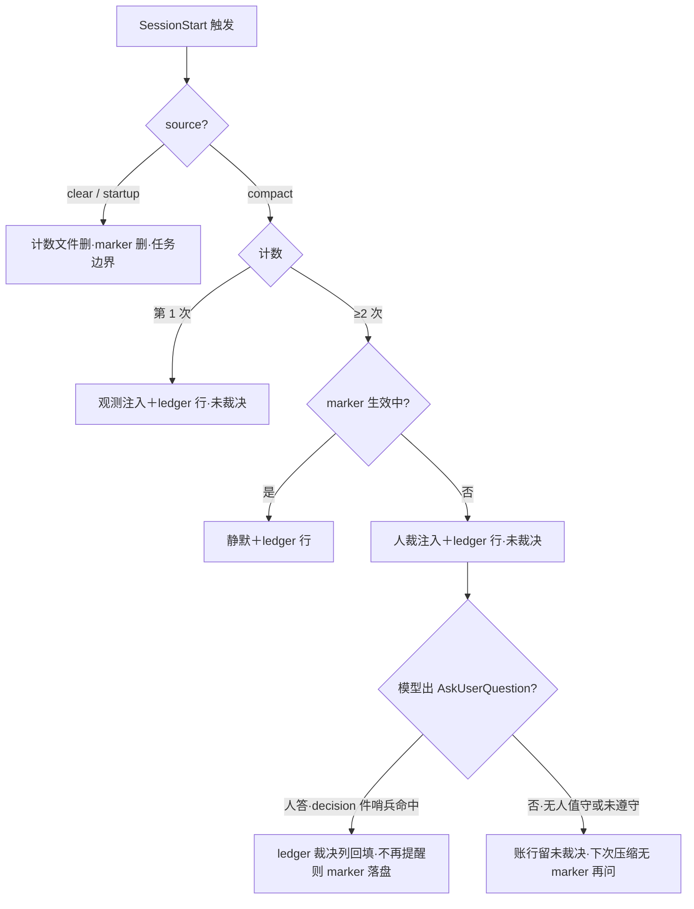

# 会话压缩计数闸（compact-gate）

> 状态：**讨论稿 v2·待需求方评审** · 2026-11-09 · 关联：需求方六条执行要求（2026-11-09）＋「弹窗人裁」提议 · 面向对象：需求方评审
> v2＝双轨评审修订稿（2026-11-09：主控平台面直核＋隔离 plan-reviewer 实读；L1×1/L2×5/L3×12 全量处置，逐条对账见 §10）。**编号约定**：§2 核心决策＝D1-D6；§9 待确认＝Q1-Q9（v1 两套 D 系列撞号已消）——需求方裁决请引 Q 编号。

## 1 目标与范围

**要解决**：同任务会话压缩无上限 → 有损代际累积（摘要失真返工、进度被迫追问、大文件反复重读）。两件套落地：

- **A. crules-flutter hooks 新增两件**（compact-gate.py 挂 SessionStart ＋ compact-gate-decision.py 挂 PostToolUse(AskUserQuestion)，后者承 Q9 通道）——结构性闸
- **B. 会话纪律文档同步收紧**（cloud-kb session-management.md v2（下称 playbook v2）＋本仓 orchestration.md 软上限 3-5→2）——纪律层配套

**不做什么**：不拦压缩本身（理由见 D1）；不动 auto-compact 配置；不替代任务划分纪律（六条之①仍归 playbook）；进度表/改动清单义务（⑤⑥）不走 hook，归 playbook 行为条目（吸收范围待 Q7）。

**老行为变更清单**：

| 件 | 现状 | 变更后 |
|---|---|---|
| hooks/hooks.json | 五件（PreToolUse×2/PostToolUse×1/Stop/SessionEnd，hooks/hooks.json:3-59） | 七件：＋SessionStart(matcher `compact\|clear\|startup`)＋PostToolUse(matcher `AskUserQuestion`) |
| orchestration.md 长批节 | 「同任务压缩 3-5 次后主动落盘重开」软上限 | 2 次硬阶梯（第1次观测/第2次人裁） |
| cloud-kb engineering/session-management.md | 决策规则表 3-5 软上限 | playbook v2：吸收六条要求＋2 次阶梯＋弹窗人裁语义（范围待 Q7） |

**盲区三扫**：异常态＝无人值守（`-p`/后台批 AskUserQuestion 不可用）→ 缺省路径（D5）涉；历史数据存量＝计数状态文件为新生物，无存量迁移，不涉；平台版本兼容＝本机 CLI 2.1.286 的 SessionStart(compact) 触发实况未实测 → **非裁决项**（无裁决选项），消解点＝阶段 1 探针先行（§6.2 探针行），挂靠见 §9 末注。

## 2 核心决策

| # | 决策（一句话） | 确定性 |
|---|---|---|
| D1 | 闸形＝**压缩后注入＋模型转手弹窗**（SessionStart(compact)→additionalContext→AskUserQuestion），不做压缩前拦截——PreCompact block 除文档面「恢复路径＝底层错误裸露、当前请求失败」外更有**死锁面**：拦掉压缩后模型仍超限，请求无从完成（§3.5） | ✅ 官方文档直取（2026-11-09 as-of；本机 2.1.286 行为探针另核） |
| D2 | **阶梯**：第 1 次压缩＝观测注入（催落快照）；**≥2 次且无 marker＝人裁弹窗**（第 3 次起再问是「放行一次」语义的自然结果，非缺口）；无人值守缺省见 D5。手动 `/compact` 与 idle compaction **同计数**（SessionStart 输入无 trigger 字段，source=compact 不分 manual/auto） | ✅ 设计（v2 修订：≥2 归一，消 ≥3 分支缺口） |
| D3 | 三选项语义：继续＝**放行一次＋记账**（下次压缩无 marker 再问）；重开＝**快照新鲜度核验后**人手 `/clear`；不再提醒＝**marker 落盘＋观测照记账**，clear 清零——三者的机械回填依赖 **Q9 回传通道，绑定裁** | ⚠️ 设计（依赖 Q9） |
| D4 | 同任务压缩上限＝**2 次**（源：需求方六条之④）——「2」为人裁**触发点非硬上限**：闸不拦压缩，人裁放行后可超，超限次数进账 | ✅ 需求方原话 |
| D5 | 无人值守缺省＝自动落快照（**遵守面**）＋继续＋账标未裁决（**机械面**：SessionStart 行初始态即未裁决，无回传即保持）；补裁通道＝下次压缩再问（无 marker 即问）或翻账——与「无人值守闸类不写」红线同构（不阻塞、不静默，memory/MAINTENANCE.md:44） | ✅ 设计（v2 修订：机械/遵守分面＋补裁落点） |
| D6 | 计数状态按 session_id 落 `<项目>/.claude/memory/compact-gate/`（**house 形**：复用 find_project_root＋sanitize_sid，hooks/_common.py:27-42，天然分工程；v1 的 `${CLAUDE_PLUGIN_DATA}` 弃用——全仓零先例、本机注入未核、跨工程混流无 project 字段）；ledger 为项目内 append-only JSONL（照 `.compliance-log` 形，hooks/compliance-audit.py:241-242）；clear/startup 删该 sid 计数与 marker；startup 时清扫 >7 天孤儿 sid 文件 | ✅ 设计（v2 修订：落点改 house 形） |

**需求方六条 → 落点映射**：①②③⑤⑥→playbook v2（行为条目，待 Q7）；④≤2 次压缩＋第 2 次落盘重开→**本闸 D2/D3/D4＋Q9 通道**。（playbook＝cloud-kb engineering/session-management.md；playbook v2＝其修订版。）

## 3 现状

**实证病灶**（转录机械取数 / 台账在档）：

| 工程 | 数据 | 取法 |
|---|---|---|
| saas-suite 批 1（2026-11） | 全天压缩 20 次、摘要失真返工 1 起、进度被迫追问 3 次 | 台账＋复盘 |
| super_printer 建库批（2026-11-09） | 4h 压缩 18 次、22KB 文件重读 ×12、写后回读 11 文件 | /tmp/pp-direct-test-1109/analyze.py 转录取数 |
| super_printer 正面形 | 任务边界 /clear 干净交接已实操（无宪法、零防护下仍复发损耗） | 同上 |

**现状对照五档**：hooks 五件 ✅ hooks/hooks.json:3-59；SessionStart 无件＝**需新增**；压缩计数器＝**需新增**；playbook 3-5 软上限＝**仅配置**（无结构保证）；模型对注入的遵守率＝**无法确认** → ❓ 非裁决项：试点实测（§6.1 判据 4，面由 Q8 定）。

## 3.5 平台能力基线（对标表）

（沉淀类必填；基线取**平台原生能力面**——hooks 设计的立论轴；确定性分级在 §2 逐条标。跨工具行业实践未查证、不在立论面，按纪律标注。）

| 维度 | 平台原生（官方 reference，2026-11-09 直取） | 本仓对照 |
|---|---|---|
| 压缩触发 | auto-compact 窗口＋`/compact` 手动＋idle compaction | 不干预 |
| 压缩前拦截 | PreCompact exit2/decision:block 可拦；**恢复路径＝底层错误裸露、当前请求失败**；无 ask 档；systemMessage 被丢弃；**死锁面**：恢复路径拦掉压缩后模型仍超限，请求无从完成 | 不采用（D1） |
| 压缩后注入 | **SessionStart(matcher `compact`＝auto or manual) 可返 additionalContext 直达 Claude**；PostCompact 无决策控制（仅日志） | 本方案主通道 |
| 人裁弹窗 | 钩子无自绘选项框；**AskUserQuestion 为普通工具名，PostToolUse 可匹配其调用与结果（tool_response 携带 answers）——Q9 通道①的可行性基线**；`-p` 需 permission host | 三选弹窗经模型转手（结构保证降半档，遵守度账兜底） |
| 任务边界信号 | SessionStart(`clear`/`startup`)、SessionEnd(reason=clear) | 计数清零挂点（D6） |

出处：https://code.claude.com/docs/en/hooks.md（加 `.md` 取带表原文，2026-11-09）。

## 4 目标方案

**候选对比**（闸位三选，平台可行性列）：

| 候选 | 机制 | 平台可行性 | 裁 |
|---|---|---|---|
| A 压缩后注入＋模型转手弹窗 | SessionStart(compact)→additionalContext→AskUserQuestion | ✅ 注入面＋弹窗工具均在 | **采用**（Q1） |
| B PreCompact block 拦截 | 压缩前 exit 2 | ❌ 恢复路径请求失败＋死锁面（§3.5） | 弃 |
| C PostCompact 后处理 | 压缩后日志事件 | ⚠️ 无决策控制，注入不可达 | 弃 |

**组件职责表**：

| 组件 | 职责 | 归属 |
|---|---|---|
| hooks/compact-gate.py | 读 session_id（**缺 sid→exit 0 不计不注**，防空串回落成共享计数文件互染）→ 维护 per-sid 计数与 marker（.claude/memory/compact-gate/）→ 按档注入（additionalContext）→ 写 ledger 行（机械记账，不依赖模型遵守） | crules-flutter 批 |
| hooks/compact-gate-decision.py（Q9① 新增件） | 挂 PostToolUse(matcher `AskUserQuestion`)：**哨兵先核**（问题文本含「[compact-gate]」），非自家毫秒级快退 exit 0；自家→读 tool_response.answers→ledger 裁决列回填；选「不再提醒」→marker 落盘 | 同上 |
| hooks/hooks.json | ＋两件；**matcher JSON 内一律裸 `compact\|clear\|startup`（本表 `\|` 仅为 markdown 转义——直抄转义形落正则路径匹配字面竖线，永不触发，防呆）** | 同上 |
| 注入文案 | **事实陈述句式**（官方指引＋house 同款 stop-reminder.py:14；祈使系统命令腔易触注入防御） | 文案随 hook 落 |
| ledger | compact-gate 专用 append-only JSONL（时间/sid/档位/裁决/未裁决标记），项目内落盘与 `.compliance-log` 同形；聚合侧按 sid 归并 | 同上 |
| playbook v2 | 六条全量吸收＋2 次阶梯＋三选项语义（**待 Q7**） | cloud-kb（需求方点头后改，独立本地 git） |
| orchestration.md | 软上限 3-5→2（已有跨工程实证笔在区，随批收口） | 本仓 |

**注入分档文案**（≤300 字符/次，远低于 10k 上限（stop-reminder.py:14 同款）；18 次/4h 工程的最坏注入成本可忽略；句式已按事实陈述体校，协议指令段除外）：

- 第 1 次：「压缩计数：本会话第 1 次压缩（同任务上限 2 次）。断点快照尚未落盘。工程纪律要求压缩后立即落快照（台账/task 回写/结论归位）；摄入面节读、不回读整文件。」
- 第 ≥2 次（无 marker 通用）：「压缩计数：第 N 次压缩，已达同任务上限（2 次）。工程纪律要求：①立即落断点快照；②以 AskUserQuestion 征询需求方裁决，问题文本以「[compact-gate]」开头，选项＝放行一次并记账／落快照后重开／本任务不再提醒；AskUserQuestion 不可用时落快照＋继续，账记未裁决。」

## 5 影响面

- **用户（需求方）**：新增弹窗交互，阈值在 ≥2 次（第 1 次纯注入不弹；人裁放行后无 marker 再问）；有「不再提醒」防疲劳出口。
- **已有功能**：既有五件零改动（新增两件独立）；宪法/换装面不动。
- **复用方回归面**：插件启用的**全部工程**即生效——super_printer 无宪法态免换装吃到闸（hooks 是唯一不依赖宪法面的层；纪律类损耗恰在此类工程复发）。**❓ 其插件启用态为消费侧事实，Q8 前提，需求方一句可消。**回归点＝七件 hooks 全量跑。
- **平台矩阵影响**：Windows 无 python3 时新两件静默失效（house 同款先例 stop-reminder.py:15，deny-list D3 降级警告兜底覆盖面实施批核）；进程期 SetErrorMode 压框三 hook 同款（stop-reminder.py:33-42）是否带入由实施批定。
- **测试构建影响**：照 test_stop_reminder.py **内联场景模式**（子进程实跑＋check 断言，无 fixture 文件；仓内另一套数据驱动夹具形见 test_deny_list，两模式不混用）加 test_compact_gate.py；无构建链改动。

## 6 测试与验收

**机制性指标为裁决轴、耗时仅参考**（单次试点 n=1 无法区分「优化生效」与「任务本身小」，特此声明）：

### 6.1 验收标准表（WHAT）

| # | 判据 | 量法 |
|---|---|---|
| 1 | 同任务压缩 ≥3 次**且无对应放行/未裁决账行**的会话数＝0（试点期） | analyze.py 转录＋ledger 对账（before 锚：super_printer 18 次/4h） |
| 2 | 闸触发即有快照：ledger 注入行时间后 30min 内，点名快照文件（STATUS.md 或 task 文件）mtime 晚于该行时间 | 文件系统机械核（锚＝ledger 注入行时间戳） |
| 3 | 「不再提醒」期间记账不断流 | compact-gate ledger 连续有行 |
| 4 | 弹窗真实出现率（模型遵守注入 → 出 AskUserQuestion） | 转录核 tool_use；❓ 遵守率本身是实测项 |

### 6.2 自测用例表（HOW；照 test_stop_reminder.py 内联场景模式）

**逻辑用例**：

| 前置 | 步骤 | 预期 |
|---|---|---|
| compact 第 1 次 | 喂 SessionStart(compact) JSON | 注入观测文案；计数=1；ledger 行·未裁决 |
| compact 第 2 次 | 同上连续 | 注入人裁文案；计数=2 |
| compact 第 3 次·无 marker | 再连续 | 仍注入人裁文案（放行一次语义）；计数=3 |
| marker 生效 | 第 2 次后 decision 件写 marker | 静默；ledger 行照落 |
| decision 自家哨兵 | 喂 PostToolUse(AskUserQuestion)·问题含「[compact-gate]」·answers=不再提醒 | marker 落盘；ledger 裁决列回填 |
| decision 自家·放行 | 同上·answers=放行一次并记账 | 无 marker；ledger 裁决=继续 |
| decision 非自家 | 喂普通 AskUserQuestion | 毫秒级快退 exit 0，零写面 |
| clear | SessionStart(clear) | 计数清零、marker 删除 |
| startup | SessionStart(startup) | 同上（双保险） |
| 坏输入/缺 sid | 缺 session_id / 坏 JSON | exit 0 不计不注 |

**平台探针行**（结果挂阶段 1 回填；本机 CLI 2.1.286）：

| 前置 | 步骤 | 预期 |
|---|---|---|
| 探针·compact 触发 | 真会话压一次 | SessionStart(compact) 触发且注入达 Claude（转录核） |
| 探针·clear/startup source | /clear 与新会话各一次 | source 值实况＋清零生效 |
| 探针·--continue 归属 | --continue 续会话 | source=resume 归属确认（不清零） |

## 7 分阶段落地

1. **阶段 0**：本文档评审（§9 Q1-Q9 全过）
2. **阶段 1**：**探针先行**（SessionStart(compact) 触发实况，§6.2 探针行）→ compact-gate.py＋compact-gate-decision.py＋hooks.json 两件＋test_compact_gate.py＋scripts/test-self.sh 枚举挂新测试（hooks 测试区 scripts/test-self.sh:38-51）＋README 概念地图速查对账行（README.md:185）（收口）
3. **阶段 2**：playbook 同步（cloud-kb v2＋orchestration.md 收紧——后者编辑已在区，随批收口；范围待 Q7）
4. **阶段 3**：试点验证（Q8 定面；analyze.py 回填 §6 实测列）

## 8 风险与回退

| 风险 | 缓解 | 回退 |
|---|---|---|
| 模型无视注入（不出弹窗/不带哨兵） | ledger 机械记账兜底（档位/计数面不依赖模型）；裁决面缺行＝遵守度账显形；效果不劣于现状（现状=零防护） | 单删 hooks.json 新增两件即回现状；状态文件无副作用 |
| 本机 2.1.286 上 SessionStart(compact) 不触发/不注入 | 探针先行实测（阶段 1 第一步） | 回退路径 B：PreCompact 计数＋UserPromptSubmit 注入（下一提示边界达，语义同「压缩后一拍」） |
| decision 件命中非自家弹窗 | 哨兵前缀先核后动，非自家毫秒级快退；PostToolUse 不阻塞主流程 | 同上单删 |
| 注入文案触发注入防御 | 事实陈述句式（官方指引＋house 同款） | — |
| 弹窗疲劳 | 阈值仅 ≥2 次＋不再提醒出口＋clear 清零 | — |
| 多会话并发同仓 | sid 分文件不互踩；ledger append-only 无锁＝house 同形（聚合侧按 sid 归并） | — |

## 9 待确认事项（评审决策点，全部阻塞实施、不阻塞本文档；责任均＝需求方）

| # | 议题 | 选项 | 建议 |
|---|---|---|---|
| Q1 | 闸位 | A 压缩后注入＋人裁（本方案）／B 压缩前 PreCompact block | A（B 有恢复路径失败＋死锁面双证，文档直取） |
| Q2 | 上限 | 2 次／3 次 | 2 次（六条之④原话）。语义注：2＝人裁触发点非硬上限（放行后可超、超限进账）；手动 `/compact` 与 idle 同计数 |
| Q3 | 「继续」语义 | 放行一次（下次再问）／放行到任务末 | 放行一次（防回现状）——**与 Q9 绑定裁**（放行额度消费的状态转移依赖回传通道） |
| Q4 | 「不再提醒」范围 | 本任务（clear 前）／本会话 | 本任务（随 clear 清零）——**与 Q9 绑定裁**（marker 写入方＝decision 件） |
| Q5 | 无人值守缺省 | 自动快照＋继续＋未裁决标记／纯观测 | 前者（不阻塞不静默；机械面=账标，遵守面=自动快照；补裁=下次压缩再问或翻账） |
| Q6 | 第 1 次是否也注入催快照 | 是／否（仅第 2 次弹窗） | 是（重开永远安全的前提）。诚实边界：第 1 次快照基于压缩后幸存信息，价值=给第 2 次重开备底稿，不恢复已丢面 |
| Q7 | playbook v2 吸收范围 | 仅压缩纪律／六条全量（含⑤⑥行为条目） | 六条全量（cloud-kb 侧点头后改；正文已标「待 Q7」三处） |
| Q8 | 试点面 | 批 2（saas-suite 在飞）／super_printer 下批／双面 | 批 2 可行；**前提 ❓ super_printer 插件启用态**（启用则优先它：before 锚在档 18 次/4h、归因干净）；批 2 注意 fan-out 子代理各 sid 各自计账，转录取数按主会话/子代理分层 |
| Q9 | 裁决回传通道（v2 新增） | ①PostToolUse(AskUserQuestion) 哨兵件／②下次 SessionStart 回扫 transcript（marker 时效劣化至第 3 次压缩才可判）／③模型自写 marker（纯遵守依赖，最弱） | ①（机械回填；平台可行性 §3.5 已核；与 Q3/Q4 绑定） |

**回填纪律**：回填四态＝已解决／部分解决附余量／未解决附影响／冲突；快照纪律＝澄清是增量、已确认基线不被覆盖；范围变更触发方案 v2 新档，不回改旧结论。
**非裁决类 ❓ 挂靠**：SessionStart(compact) 触发实况→阶段 1 探针先行；模型遵守率→判据 4 试点实测（面由 Q8 定）。两项无裁决选项，不阻塞 Q1-Q9。

## 10 评审修订记录（v1→v2，2026-11-09）

评审来源：主控平台面直核（官方 hooks reference 当日直取）＋隔离 plan-reviewer（仓内事实逐条实读，无网）。总裁决：**有条件过**。18 条发现全量处置：

| 发现 | 等级 | 处置（落点） |
|---|---|---|
| 裁决回传通道缺失（marker/裁决列无写入方，D3/D4 按现稿不可实现） | L1 | §4 新增 decision 件＋Q9；D3/D4 改绑定标注 |
| ≥3 次分支未定义＋判据 1 与「放行一次」自相矛盾 | L2 | D2 归一「≥2 无 marker 即问」；判据 1 加「无对应账行」条件 |
| `${CLAUDE_PLUGIN_DATA}` 零先例（无回落/注入未核/跨工程混流） | L2 | D6 改 house 形落点 `.claude/memory/compact-gate/` |
| §6.2 缺平台探针行 | L2 | §6.2 探针三行（结果挂阶段 1 回填） |
| 两套 D 系列撞号（§2 vs §9） | L2 | §9 重编号 Q1-Q9，头部编号约定 |
| 样例文案祈使腔与自述纪律矛盾 | L2 | §4 文案事实陈述体重写＋哨兵指令段声明 |
| D8 双载（试点面＋触发实测），❓ 指针落空 | L3 | 盲区三扫改指探针；§9 非裁决类挂靠行 |
| 引文窗口「hooks.json:1-51」不实 | L3 | 改 hooks.json:3-59（实 61 行） |
| 「fixtures」混称仓内两套测试模式 | L3 | 归一内联场景模式（§5/§6.2） |
| 骨架缺口四项（候选对比/3.5 正名/平台矩阵行/§9 责任列） | L3 | §4 候选对比表；§3.5 改名对标表；§5 平台矩阵行；§9 责任行＋回填纪律 |
| 判据 2 不可机械核（快照文件/时间锚未定义） | L3 | 锚 ledger 注入行时间＋点名快照文件 |
| 缺 session_id 计数语义未定义 | L3 | exit 0 不计不注（防空串回落共享文件互染） |
| 「人回来补裁」无浮现通道 | L3 | D5 补裁落点＝下次压缩再问/翻账 |
| 实施触达件不全（test-self 枚举/速查落点） | L3 | §7 阶段 1 点名 scripts/test-self.sh:38-51＋README.md:185 |
| D7 未裁先入正文＋playbook 术语无定义 | L3 | 三处「待 Q7」标＋§1/§2 playbook 定义 |
| 手动 `/compact` 同计数未言明 | L3 | D2/Q2 语义注（SessionStart 无 trigger 字段） |
| matcher 转义陷阱（`\|` 直抄永不匹配） | L3 | §4 组件表防呆注 |
| super_printer 插件启用态写成事实 | L3 | §5 改 ❓ 前提，挂 Q8 |
